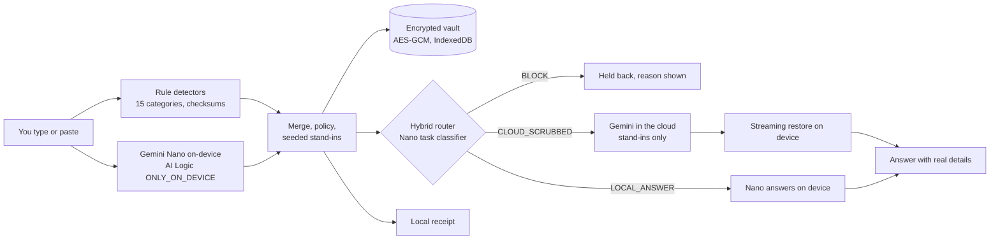

# Airlock

**Use any cloud AI without leaking secrets.** *Your secrets stay on this side of the door.*

Airlock puts a private model on your own device (Gemini Nano in Chrome, through Firebase AI Logic hybrid inference) between you and any cloud AI. It finds sensitive details and swaps them for realistic stand-ins before anything leaves. Only the cleaned text reaches the cloud model, and the answer comes back with your real details restored, locally.

> Built with Kiro; reviewed with Claude Code. See [docs/KIRO_LOG.md](docs/KIRO_LOG.md) for exactly who wrote what.

**Built with:** Kiro, Firebase AI Logic (hybrid inference), Gemini Nano, Gemini API, Firebase App Check, Remote Config, Auth, Firestore, Hosting, React 19, TypeScript, Vite, fast-check, Vitest, Playwright, Claude Code.

**Kiro at a glance** (everything is in [`/.kiro`](.kiro)):

| Kiro feature | What it did here |
|---|---|
| [Steering](.kiro/steering) | product, tech, structure, design, and `privacy-invariants.md`, which every change is checked against |
| [Specs](.kiro/specs) | `architecture-skeleton` (every file of the app as typed, wired stubs) and `scrub-engine` (EARS requirements and 9 correctness properties) |
| Property-based testing | the 9 properties run 1,000 times each with fast-check; one shrank to a real card-number leak, which was then fixed |
| [Hooks](.kiro/hooks) | a secret guard that runs Airlock's own detector on every prompt sent to Kiro, plus test-on-save, PBT after each task, a privacy review on agent stop, and docs sync |
| [Custom agents](.kiro/agents) | `leak-auditor` (hunts for data-egress paths) and `copy-editor` (voice rules) |
| [MCP](.kiro/settings/mcp.json) | Firebase, Playwright and GitHub servers, with no tokens in the file |

## Why

People paste client names, salaries, medical notes, contracts and API keys into chatbots every day. Companies either ban AI, so people use it anyway on personal devices, or they buy cloud DLP. Cloud DLP checks your prompt by sending it to yet another company first. Plain `[REDACTED]` masking breaks the model's reasoning.

Airlock makes **the device the trust boundary**: detection, pseudonymisation and restore all happen on your laptop. **The cloud model is the capability**: it reasons over natural-reading text with consistent stand-ins ("Priya Shah at Acme Corp" becomes "Maya Iyer at Northwind Labs").

## Features

- **Airlock Chat** (`/chat`): live redaction preview, the animated airlock chamber, three views per turn (what you wrote, what was sent, the restored answer), multi-turn cloud chat on scrubbed history only, and streaming answers with restore across chunk boundaries.
- **Hybrid router**: every message is answered on-device (`LOCAL_ANSWER`), sent cleaned to the cloud (`CLOUD_SCRUBBED`), or held back (`BLOCK`), with a plain-English reason. You can force "my device only" or "cloud" for each message.
- **Realistic, consistent stand-ins**:
  - Indian names stay Indian, and name parts are kept.
  - Aliases are tracked: "Ms. Iyer" restores to "Ms. Shah".
  - Emails use reserved `.example` domains.
  - Phones end in `0000x`.
  - Cards fail Luhn and Aadhaar numbers fail Verhoeff, so a fake can never be a real ID.
- **Secrets are never sent**: API keys, tokens, private keys and passwords become `‹secret-N›`.
- **Encrypted local vault**: session mappings are AES-GCM encrypted under a non-extractable WebCrypto key in IndexedDB. There's a 24 h TTL and "Forget this session".
- **Receipts** (`/receipts`): what left your device, the route and reason, `inferenceSource` for each step, counts and detectors. Stored locally, never uploaded.
- **Clipboard airlock** (`/clipboard`): clean and copy for *any* AI tool, then paste the answer back and restore it.
- **Org mode** (`/org`): admins set protected terms and policies, which members apply on-device. Stats are counts only; Firestore rules reject content.
- **Leak benchmark** (`/bench`): seeded synthetic documents with planted secrets, comparing no protection, rules only, and rules + Nano, in your own Chrome.
- **Graceful degradation**: without Nano, Airlock uses its rule checks only, says protection is reduced, and asks for consent before any cloud call.

## How Firebase AI Logic is used

| What | Mode | Where |
|---|---|---|
| Sensitive-span detection on raw text, structured output with the exact JSON schema | `InferenceMode.ONLY_ON_DEVICE`, `onDeviceParams.promptOptions.responseConstraint` | [packages/nano-detector/src/models.ts](packages/nano-detector/src/models.ts), [detection.ts](packages/nano-detector/src/detection.ts) |
| Task classification for the router (enum output) | `ONLY_ON_DEVICE` | [classification.ts](packages/nano-detector/src/classification.ts) |
| Local answers on the original text (`LOCAL_ANSWER`) | `ONLY_ON_DEVICE`, streaming | [answer.ts](packages/nano-detector/src/answer.ts) |
| Cloud answers on scrubbed text and scrubbed history only | `InferenceMode.ONLY_IN_CLOUD`, `generateContentStream` | [apps/web/src/lib/cloud-client.ts](apps/web/src/lib/cloud-client.ts), [firebase/ai.ts](apps/web/src/firebase/ai.ts) |
| Model download from a user gesture, with progress | `GenerativeModel.initializeDeviceModel()` | [init.ts](packages/nano-detector/src/init.ts), [lib/session.ts](apps/web/src/lib/session.ts) |
| `inferenceSource` on every step | `response.inferenceSource` | recorded in each receipt ([lib/session.ts](apps/web/src/lib/session.ts)) |

App Check runs before any AI Logic call (a debug token in dev, reCAPTCHA v3 in prod), in [firebase/appCheck.ts](apps/web/src/firebase/appCheck.ts). Model names, thresholds and flags live only in Remote Config ([firebase/remoteConfig.ts](apps/web/src/firebase/remoteConfig.ts)). The `ScrubbedText` branded type means raw text can't be passed to the cloud client.

## Architecture

Monorepo (npm workspaces):
- `packages/scrub-engine`: pure TypeScript. It holds the rule detectors, merge, policy, stand-ins, restore and the secret guard, plus 9 property tests at 1,000 runs each. It has no DOM or Firebase code, so it can be reused (`airlock-gate`).
- `packages/nano-detector`: the Firebase AI Logic wrapper.
- `apps/web`: Vite, React 19 and react-router.

## Privacy guarantees (tested)

The scrub engine's invariants are fast-check properties (`npm run test:props`, 1,000 runs each):

1. **No leak:** no planted secret appears in the outbound text.
2. **Round trip:** `restore(scrub(x)) === x` when every category is pseudonymised.
3. **Consistency:** the same original gets the same stand-in across a session.
4. **Injectivity:** distinct originals never share a stand-in.
5. **Non-collision:** no stand-in appears inside any original text of the session.
6. **Fakes stay fake:** card stand-ins fail Luhn, Aadhaar stand-ins fail Verhoeff, emails use `.example`, phones end in `0000x`.
7. **Determinism:** the same seed and findings give the same output.
8. **Idempotence:** re-scrubbing scrubbed text finds nothing new.
9. **Streaming equivalence:** restoring a stream chunk by chunk equals restoring the whole string.

Firestore rules are tested in the emulator (`npm run test:rules`). Members can only increment counts, content fields are rejected, joining needs the invite code, and the creator becomes admin only in the same batch.

## Benchmark

Run it yourself at `/bench`. These are the results for seed 2026, 60 documents and 369 planted secrets, in Chrome:

| Setup | Leaked | Notes |
|---|---|---|
| No protection | 369 of 369 | baseline |
| Rules only | 224 of 369 | 100% recall and precision on every structured type (email, phone, Aadhaar, PAN, IFSC, account, card, UPI, keys, JWT, password, IP, URL secrets); contextual types (names, orgs, places, health, legal, amounts, projects, dates) need Nano |
| Rules + Gemini Nano | run `/bench` in Chrome with Nano enabled | results are recorded by the page as JSON |

## Setup

Requirements: Node 22+, and Chrome desktop 139+ for on-device protection.

1. `npm install`
2. Copy `.env.example` to `apps/web/.env.local` and fill in the Firebase web config of your project. Then, in the Firebase console:
   - enable **AI Logic** with the Gemini Developer API;
   - enable **App Check** (reCAPTCHA v3) and register the debug token the dev build prints;
   - optionally enable Google sign-in and Firestore for org mode.
3. In Chrome, open `chrome://flags/#prompt-api-for-gemini-nano-multimodal-input`, set it to **Enabled**, and restart. Airlock shows "On-device protection: ready" once Nano is available, or an **Enable** button that downloads it.
4. `npm run dev`, then open http://localhost:5173

Checks: `npm run typecheck`, `npm run lint`, `npm run test:unit`, `npm run test:props`, `npm run test:rules` (needs Java for the emulator) and `npm run build`.

Stand-in phone numbers, cards, Aadhaar and PAN numbers are deliberately fake (they fail their checksums, or use reserved ranges and domains). All test and demo data in this repo is fictional.

## Kiro

Kiro was used for steering, the architecture-skeleton spec, the frontend, and the scrub-engine spec (EARS requirements, correctness properties). It also provides hooks, custom agents and MCP:
- Hooks: the secret guard on prompt submit, test-on-save, PBT after each task, a privacy review on agent stop, and docs sync.
- Agents: `leak-auditor` and `copy-editor`.
- MCP: Firebase, Playwright and GitHub.

The full log, including what Claude Code implemented after Kiro's credits ran out, is in [docs/KIRO_LOG.md](docs/KIRO_LOG.md).

## License

[Apache-2.0](LICENSE), Copyright 2026 Safal Mutha.
